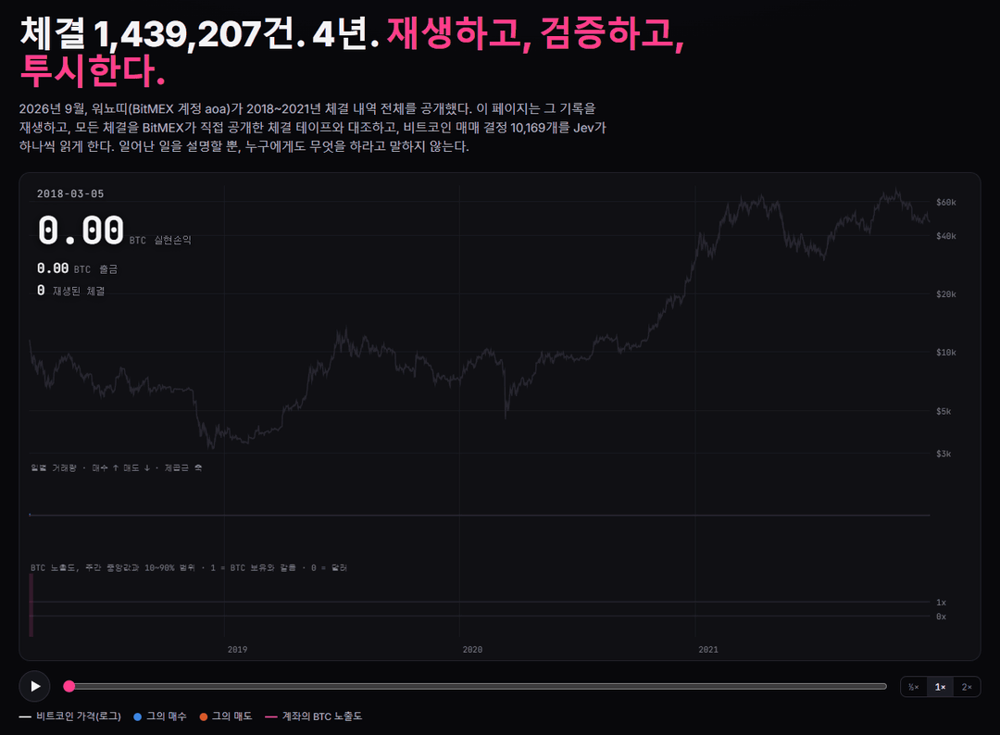
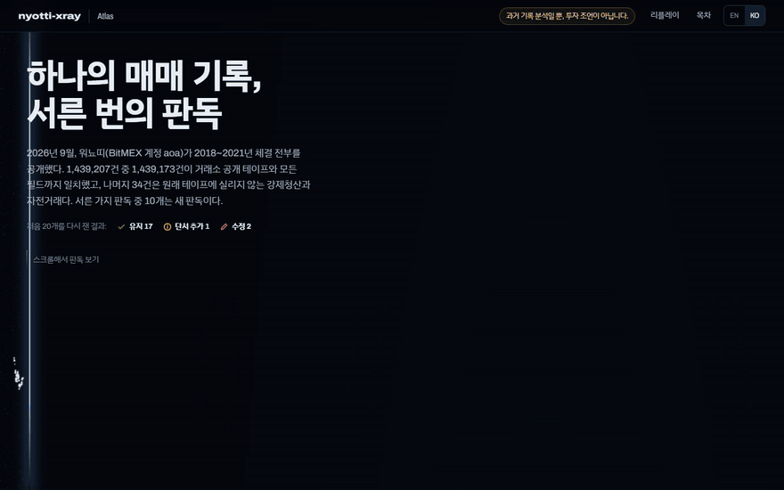

<p align="center">
  
</p>

<h1 align="center">nyotti-xray</h1>

<p align="center">
  <b>유명 트레이더가 2018~2021년 체결 전부를 공개했다. 그 기록을 재생하고, 거래소가 직접 공개한 체결 테이프와 대조하고, 결정 하나하나를 Jev가 읽게 했다.</b><br>
  <a href="https://viva-lee.github.io/nyotti-xray/atlas.html?lang=ko"><b>아틀라스 열기</b></a> · <a href="https://viva-lee.github.io/nyotti-xray/?lang=ko">리플레이 열기</a> · 설치 없이 브라우저에서<br>
  따라 하지 않고 검증한다 · 신호 없음 · 봇 없음 · <a href="README.md">English</a>
</p>

---

> **투자 조언이 아닙니다.** 기록의 주인이 스스로 공개한 과거 자료에 대한 독립적인 비공식 분석입니다. 실시간 데이터, "지금 그라면?", 전략, 봇, 그를 따라 했을 때의 백테스트가 없습니다. 워뇨띠, BitMEX, TypeSafe와 무관합니다. 데이터와 함께 공개된 서한에서 그는 이렇게 썼습니다. *"매매봇이 실제 수익이 날 것 같을 경우 이미 자료가 있는 제가 먼저 만들어서 돌리고 있었을 것입니다. 절대 속지 말고 구매도 하지 않으셨으면 좋겠습니다."*

2026-09-22, **워뇨띠**(BitMEX 계정 `aoa`)가 BitMEX 체결 내역 전체를 공개했다. 2018-03-05부터 2021-12-24까지 **체결 1,439,207건**과 지갑 원장이다. `nyotti-xray`는 이 자료로 네 가지를 만든다.

1. **리플레이.** 4년치 체결이 30초 동안 비트코인 가격 위로 쏟아지고, 실현손익 카운터가 0에서 3,537.32 BTC까지 올라간다.
2. **검증.** 모든 체결의 거래 ID를 [BitMEX 공개 체결 테이프](https://public.bitmex.com/?prefix=data/trade/)(거래소의 모든 체결을 익명으로 기록한 자료)에서 찾아 필드 단위로 대조한다. **체결 1,439,207건 중 1,439,173건이 테이프에 있고 모든 필드가 일치한다**: 종목, 가격, 수량, 시각, 메이커/테이커 방향. 1,402일, 공개 체결 9억 3,660만 건(35.7GB)을 훑었다. 나머지 34건은 호가창이 아니라 청산 엔진으로 넘어가는 강제청산 체결 28건과, 자기 주문끼리 맞붙은 자전거래 3쌍이다.
3. **X-ray.** 비트코인 결정 10,169개마다 그 순간의 시장과 계좌 상태를 코드가 짧은 영어 묘사로 바꾸고, [Jev](https://typesafe.ai)가 여덟 가지 질문에 보정된 확률로 답한다. 시장 국면, 패닉 매도장이었는지, 손실 직후였는지, 얼마나 과감했는지 같은 질문이다. 전체 한 번에 약 **$0.67**가 든다(실측: 요청 9,594건, 입력 1,500만 토큰, $0.63, 요청당 중앙 지연 213ms, `jev-1.13.0`).
4. **아틀라스.** 기록을 서른 가지로 판독한 한 페이지([바로 열기](https://viva-lee.github.io/nyotti-xray/atlas.html?lang=ko), `site/atlas.html`)다. 처음 발견 20개를 다른 방법으로 다시 재고, 새 판독 10개를 더했다. 점 24,000개가 판독마다 새 차트로 다시 스캔되고, 점 하나하나가 기록 속 실제 단위다. 하루, 주문 하나, 결정 하나, 비트코인 하나.

<p align="center">
  
</p>

## 발견한 것

| | |
|---|---|
| **봇은 한 번도 없었다** | 체결의 100%가 www.bitmex.com에서 넣은 주문이거나 강제청산이다. 4년 동안 API 주문은 한 건도 없다. |
| **14.5 BTC 입금, 2,814.5 BTC 출금** | 입금 18번, 전부 2018년. 완료된 출금 56번(파일에는 취소된 출금 7건도 있다). 마지막 잔고는 737.27 BTC. |
| **0.03% 오차로 재구성** | 모든 체결을 평균단가 장부로 재생하면 지갑의 실현손익이 재현된다: 3,538.49 대 3,537.32 BTC. 지갑처럼 UTC 정오부터 정오까지로 세면 어느 해도 0.88 BTC 넘게 어긋나지 않는다. |
| **스캘핑에서 스윙으로** | 계약 가중 보유시간 중앙값: 17분(2018) → 1.1시간 → 6.2시간 → 19.2시간(2021). |
| **숏 시간의 대부분은 하락 베팅이 아니었다** | 2019~2021년 대부분 XBTUSD 순숏이었지만 증거금이 비트코인이었다. 숏인 시간을 계좌 전체의 노출도로 나누면 25%는 실제 하락 베팅, 32%는 계좌를 달러로 파킹, 13%는 일부 헤지, 30%는 여전히 BTC 보유와 비슷한 계좌를 숏이 조금 덜어냈을 뿐이다. |
| **커질수록 줄어든 레버리지** | 총 레버리지 95백분위 8.6배(2018) → 2.1배 → 2.4배 → 2.7배(2021). 계좌에 수백 달러뿐이던 2018년 3월에는 48배까지 갔다. |
| **2021년에는 펀딩비를 받았다** | 2018~2020년엔 해마다 5~10 BTC를 냈고, 2021년에는 171.1 BTC를 받았다. 4년 합계로 수수료와 펀딩은 수입이었다. |
| **2018년 강제청산 27번** | 이후로는 두 번, 576계약과 126계약뿐이다. |
| **몰려 있는 수익** | 66%의 날이 플러스였지만 상위 14일이 순이익의 절반을 만들었다. |
| **최악의 날** | 2021-05-19: 노출도 0.41배로 시작해 폭락 중에 사들여 3.44배까지 갔고, 그날 계좌는 BTC 기준 가치의 51.1%를 잃었다. 다음 이틀은 +21.4%, +40.3%. |
| **거래소에서 가장 컸던 날** | 2021-06-21: BitMEX 전체 XBTUSD 거래량의 9.3%. |
| **복수 매매 검사** | 자산이 타격을 입은 직후 Jev의 과감함 점수(0~4)는 1.68, 평소는 1.61이었고, 거래 크기 중앙값은 평소의 0.92배였다. 차이는 작고 방향도 엇갈린다. |

위 숫자는 모두 이 레포의 코드가 계산했고, 페이지에 계산 과정과 함께 나온다.

## 두 번째 판독

처음 발견은 모두 다른 방법으로 다시 쟀다([`nyotti/analyses/review.py`](nyotti/analyses/review.py)). **17개 유지, 1개 단서 추가, 2개 수정**. 새 판독은 10개다.

| | |
|---|---|
| **제목 두 개가 숫자보다 앞서 나갔다** | "숏은 대부분 달러로 파킹": 계좌가 달러로 파킹된 숏 시간은 32%뿐이다. "Against the move, more often than not"(흐름을 거스른 매매가 더 많다): 결정의 40.6%가 24시간 흐름을 거슬렀는데, 매수 비중이 같고 방향만 무작위여도 39.9%가 나온다. 거스르는 쪽으로 기운 해는 2021년(48% 대 43%)뿐이다. 두 카드는 다시 썼다. |
| **주문 방식에 단서 추가** | 거래 금액으로 세면 메이커 비중은 65% → 68% → 71% → 81%로 꾸준히 올랐다. 건수로 세면 2019~2020년이 더 공격적으로 보이는데, 테이커 주문 하나가 부딪힌 대기 주문마다 체결로 쪼개지기 때문이다. |
| **클릭에도 쉬는 시간이 없다** | 걸어 둔 주문은 자는 동안에도 체결되므로, 보내는 즉시 체결된 주문 11,225개로 시계를 다시 그렸다. 이것도 하루 전체에 퍼져 있다. |
| **4년 동안 스톱 주문 40개** | 2018년 33개, 2021년 0개. 아이스버그 주문은 없고, 숨긴 주문의 체결은 0.2%다. |
| **이긴 계약은 빨리, 진 계약은 오래** | 청산을 가장 최근 진입분과 짝지으면(LIFO) 손실로 닫힌 계약이 이익으로 닫힌 계약보다 매년 1.7~3.8배 오래 보유됐다. 오래된 진입분부터 짝지어도 순서는 같다. |
| **추가 매매 세 번 중 두 번은 손실 중인 포지션에** | 추가 매매 3,480번 중 65%가 가격이 이미 포지션 반대로 움직인 뒤였다. 진입가에서 중앙값 0.7% 벗어난 지점이다. |
| **계좌는 0에서 얼마나 떨어져 있었나** | 계좌를 0으로 만들 수 있었던 가장 작은 BTC 변동폭(시간 단위): 2.0%(2018) → 18.5% → 27.7% → 29.1%(2021). |
| **달러로 세면 최악의 날이 바뀐다** | 2020년 최대 낙폭은 달러 기준 −52%(블랙 서스데이)였지만 비트코인 기준으로는 −36%, 11월에 비트코인이 30일 동안 54% 오른 뒤였다. |
| **분기마다 계좌는 무엇이었나** | 해마다 노출도 중앙값은 1배, 즉 비트코인 보유와 같았지만 구성은 바뀌었다: 2019년은 31%의 날이 달러로 파킹, 2021년 3분기는 65%의 날이 레버리지 롱. |
| **2018년, 한 달씩** | 레버리지 95백분위가 3월 32배(강제청산 10번)에서 12월 2.9배로 내려왔다. |
| **출금은 고점 근처에서 나갔다** | 출금 56번 중 57%가 30일 최고 자산의 5% 이내에서 나갔다. 그해 실현손익 대비 출금: 44% → 50% → 81% → 89%. |
| **최고의 날 다음 날** | 최고의 날 뒤에도, 최악의 날 뒤에도 평소보다 바빴고, 어느 쪽에서도 거래는 커지지 않았다. 최악의 날 다음 날 그가 거래한 계약은 BTC 노출도를 자산 대비 중앙값 0.21배 올렸고, 최고의 날 다음 날에는 0.00배였다. |

## 빠른 시작

Python 3.10 이상과 pandas, numpy, pyarrow가 필요하다. 뷰어는 의존성 없는 정적 HTML이다.

```bash
git clone https://github.com/viva-lee/nyotti-xray && cd nyotti-xray
pip install -r requirements.txt
python -I bin/nyotti.py fetch      # 원본 구글 드라이브 링크에서 113MB, SHA-256 확인
python -I bin/nyotti.py build      # 계좌 장부, 노출도, 결정 10,169개 (약 1분)
python -I bin/nyotti.py analyze    # 발견 카드, 재검증, 아틀라스 데이터 → site/data
python -I bin/nyotti.py serve      # http://127.0.0.1:4343 (리플레이), /atlas.html (판독 30개)
```

오래 걸리는 선택 단계:

```bash
python -I bin/nyotti.py tape --workers 24    # 공개 테이프 약 36GB 스트리밍, 체결 전수 대조 (네트워크가 병목)
cp .env.example .env                         # console.typesafe.ai 에서 받은 키 입력
python -I bin/nyotti.py judge                # Jev 질문 8개 × 결정 10,169개, 약 $0.67
```

`-I`는 작업 폴더의 파일을 파이썬 모듈로 불러오지 않게 한다. 데이터 폴더에 인터넷에서 받은 파일이 있기 때문이다. 원본 데이터는 커밋하지 않는다. `fetch`가 본인 링크에서 내려받고, SHA-256이 `b6f1dc7a…d01b9a`와 다르면 쓰지 않는다.

## 작동 방식

**장부.** 인버스 계약(XBTUSD와 XBT 만기 선물)은 `n/p` BTC, 콴토·리니어 계약은 `n·p·m` BTC로 원가를 잡는다. 승수 `m`은 체결의 `execcost`에서 읽는다. 미실현 손익은 테이프의 시간별 가격으로 평가한다. 자산 = 입금 − 출금 + 실현손익 − 수수료·펀딩 + 미실현손익. 정리할 것이 두 가지 있었다. 지갑 파일에 취소된 출금 7건(17.99 BTC)이 섞여 있어 빼야 하고, 엑셀이 입출금 시각에서 '시'를 지워서 입금은 그날 처음, 출금은 그날 마지막으로 잡았다.

**BTC 노출도**는 `1 + XBT 순계약 / (가격 × 자산)`이다. 비트코인을 증거금으로 쓰는 인버스 계약에서 1.0은 비트코인을 그냥 들고 있는 것과 같고, 0은 달러, 0 미만은 비트코인이 떨어질 때 버는 상태다.

**결정**은 같은 방향의 XBTUSD 체결 중 간격이 20분 이하인 것들을 묶은 단위다.

**Jev가 보는 것.** Jev는 계산기가 아니라 판단 모델이라서 숫자는 전부 코드가 계산하고, 이름 붙은 구간과 수치를 함께 넘긴다("fell sharply (-25.4%)"). 트레이더의 이름은 절대 넣지 않고, 결정 이후의 정보도 넣지 않는다(둘 다 단위 테스트로 확인한다). Jev는 영어에서 가장 정확하므로 묘사는 영어로 쓴다. 질문 여덟 개는 [`lenses/default.json`](lenses/default.json)에 있다. 그중 *24시간 흐름 역행*과 *포지션 확대*는 코드로 정답을 알 수 있어서, 일치율이 Jev가 묘사를 제대로 읽는지에 대한 상시 점검이 된다.

## 한계

- 체결 기록은 하지 *않은* 일을 보여주지 못한다. 보류한 주문, 체결 전에 취소하거나 옮긴 주문이 그렇다. 그 자신도 이 점을 지적했다.
- 결정과 Jev 렌즈는 XBTUSD(체결의 65%)만 다룬다. 알트코인은 장부, 손익, 레버리지에는 들어간다.
- 입출금 시각에서 '시'가 사라져, 입출금 전후 몇 시간의 자산 값은 조금 어긋날 수 있다.
- Jev는 차트가 아니라 묘사를 판단한다. 묘사가 달라지면 답도 달라진다. 묘사는 코드에 있고, 뷰어에서 점마다 볼 수 있다.

---

<sub>독립 프로젝트. 워뇨띠, BitMEX, TypeSafe AI와 무관하다. 그가 이 데이터로 만든 것을 팔지 말아 달라고 했기에 무료, MIT 라이선스다. Jev는 TypeSafe의 모델이며 키는 각자 준비한다.</sub>
