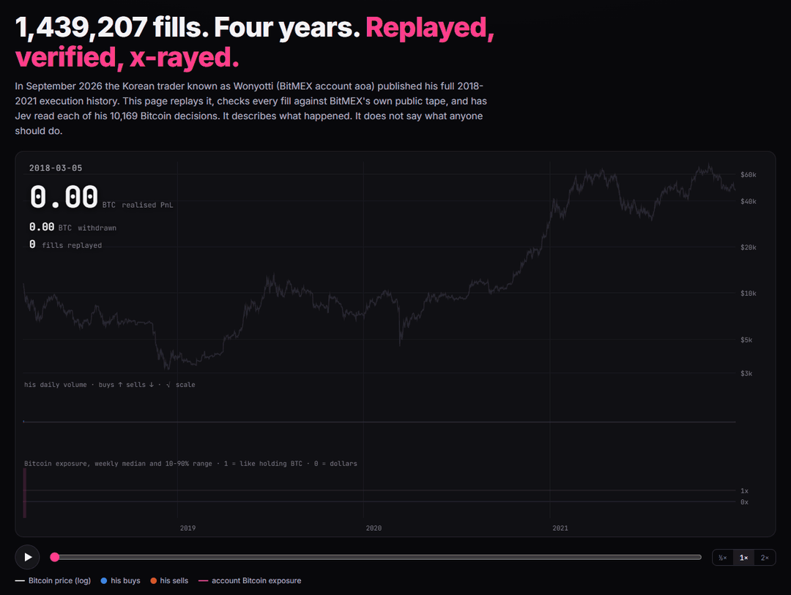
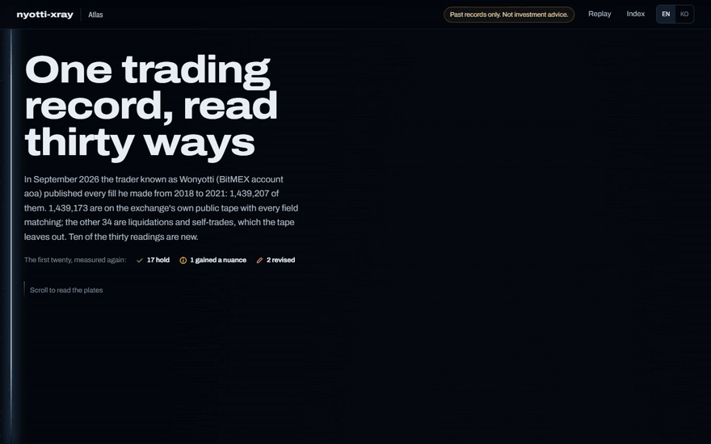
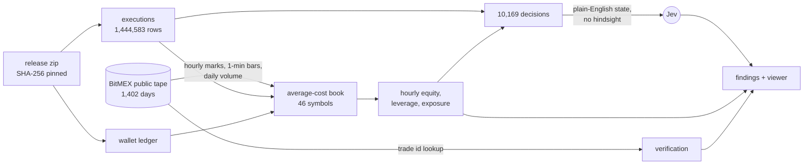

<p align="center">
  
</p>

<h1 align="center">nyotti-xray</h1>

<p align="center">
  <b>A famous trader published every fill he made from 2018 to 2021. This replays it, checks it against the exchange's own tape, and has Jev read each decision.</b><br>
  Verified, not imitated · no signals · no bot · <a href="README.ko.md">한국어</a>
</p>

---

> **Not investment advice.** This is an independent, unofficial analysis of historical records the owner chose to publish. It has no live data, no "what would he do now", no strategy, no bot and no backtest of copying him. It is not affiliated with him, BitMEX or TypeSafe. In the letter that came with the data he wrote: *"If a trading bot looked like it would really make money, I already have the data, so I would have built it and run it first. Please don't be fooled, and don't buy one."*

On 2026-09-22 the Korean trader known as **Wonyotti** (BitMEX account `aoa`) released his full BitMEX execution history: **1,439,207 fills** from 2018-03-05 to 2021-12-24, plus his wallet ledger. `nyotti-xray` turns that release into three things:

1. **A replay.** Four years of fills fall onto the Bitcoin price in 30 seconds while the realised PnL counts up from 0 to 3,537.32 BTC.
2. **A proof.** Every fill's trade id is looked up on [BitMEX's public trade tape](https://public.bitmex.com/?prefix=data/trade/), the anonymous record of every trade on the exchange, and checked field by field. **1,439,173 of 1,439,207 fills are on the tape with every field matching**: symbol, price, size, timestamp and maker/taker side, across 1,402 days and 936.6M public trades (35.7 GB). The other 34 are 28 liquidation fills, which go to the liquidation engine instead of the order book, and 3 self-trades where his own orders crossed.
3. **An x-ray.** Code turns the market and the account at each of his 10,169 Bitcoin decisions into a short English description, and [Jev](https://typesafe.ai) answers eight typed questions about it with calibrated probabilities: what regime the market was in, whether it was panic selling, whether he had just taken a loss, how bold the trade was. A full pass costs about **$0.67** (measured run: 9,594 requests, 15.0M input tokens, $0.63, median 213 ms per request, `jev-1.13.0`).
4. **An atlas.** Thirty readings of the record on one page (`site/atlas.html`): the twenty original findings, each measured again another way, and ten new ones. 24,000 points re-scan into a new chart for every plate, and every point is a real unit of the record: a day, an order, a decision, a bitcoin.

<p align="center">
  
</p>

## What it found

| | |
|---|---|
| **No bot, ever** | 100% of fills came from orders placed on www.bitmex.com, or from liquidations. Not one API order in four years. |
| **14.5 BTC in, 2,814.5 BTC out** | 18 deposits, all in 2018. 56 completed withdrawals (7 canceled ones are in the file too). 737.27 BTC left at the end. |
| **Rebuilt to 0.03%** | Replaying every fill through an average-cost book reproduces the wallet's realised PnL: 3,538.49 vs 3,537.32 BTC. Counted noon to noon UTC, the way the wallet books it, no year is off by more than 0.88 BTC. |
| **Scalps to swings** | Contract-weighted median hold: 17 min (2018) → 1.1 h → 6.2 h → 19.2 h (2021). |
| **Most "short" hours were not a bet on a fall** | Net short XBTUSD most of 2019-2021, but his margin was Bitcoin. Sorting those hours by the whole account's exposure: 25% were a real bet on a fall, 32% parked the account in dollars, 13% hedged part of it, and in 30% the short only trimmed an account still about like holding Bitcoin. |
| **Leverage fell as he grew** | 95th-percentile gross leverage 8.6x (2018) → 2.1x → 2.4x → 2.7x (2021), after touching 48x in March 2018 with a few hundred dollars in the account. |
| **Paid to hold in 2021** | 171.1 BTC of funding received in 2021, after paying 5-10 BTC a year before. Fees and funding over four years net out to income. |
| **Liquidated 27 times in 2018** | Then twice more, for 576 and 126 contracts. |
| **Lumpy profits** | 66% of days were green, but the best 14 days made half of the net. |
| **His worst day** | 2021-05-19: starting 0.41x exposed, he bought into the crash, reached 3.44x, and the account lost 51.1% of its BTC value that day. The next two days: +21.4%, +40.3%. |
| **His biggest day on the exchange** | 2021-06-21: 9.3% of all XBTUSD contracts traded on BitMEX. |
| **The tilt check** | Right after his equity took a hit, Jev scored his trades 1.68 for boldness (0-4) against 1.61 otherwise, while the median trade was 0.92x his usual size. Small differences, in both directions. |

Every number above is computed by the code in this repo and shown with its working on the page.

## The second look

Each original finding was measured again another way ([`nyotti/analyses/review.py`](nyotti/analyses/review.py)): **17 hold, 1 gained a nuance, 2 were revised**. Ten readings are new.

| | |
|---|---|
| **Two titles said too much** | "'Short' mostly meant 'in dollars'": only 32% of short hours left the account parked in dollars. "Against the move, more often than not": 40.6% of decisions went against the 24-hour move, where random sides with his buy share would give 39.9%. Only 2021 leans against it, 48% vs 43%. Both cards were rewritten. |
| **A nuance on order craft** | By dollar volume his maker share rose steadily, 65% → 68% → 71% → 81%. Fill counts make 2019-2020 look more aggressive, because one taker order splits into a fill for every resting order it hits. |
| **No quiet hours, even for clicks** | Resting orders fill while their owner sleeps, so the clock was re-run on the 11,225 orders that traded the instant they were sent. Those are spread over the whole day too. |
| **40 stop orders in four years** | 33 in 2018, none in 2021. No iceberg orders; hidden orders are 0.2% of fills. |
| **Winners closed sooner than losers** | Pairing closes with the newest open contracts (LIFO), pieces closed at a loss had been held 1.7-3.8x longer than pieces closed at a gain, in every year. Oldest-first matching gives the same order. |
| **Two of three adds went into a losing position** | 65% of his 3,480 adds came after the price had already moved against the position, a median 0.7% past the entry. |
| **How far the account sat from zero** | The smallest Bitcoin move that could have emptied the account, hour by hour: 2.0% (2018) → 18.5% → 27.7% → 29.1% (2021). |
| **Count in dollars and the worst days move** | 2020's deepest fall was −52% in dollars, on Black Thursday, but −36% in bitcoin, in November, after Bitcoin had risen 54% in 30 days. |
| **What the account was, quarter by quarter** | The median hour of every year sat at 1x exposure, like plain Bitcoin, but the mix moved: 31% of 2019's days parked in dollars, 65% of 2021 Q3's days a leveraged long. |
| **2018, month by month** | 95th-percentile leverage fell from 32x in March, with 10 liquidations, to 2.9x in December. |
| **Withdrawals came near the highs** | 57% of the 56 withdrawals came within 5% of a 30-day equity high. Withdrawn share of each year's realised PnL: 44% → 50% → 81% → 89%. |
| **The day after his best days** | Busier after both his best and worst days, and his trades got bigger after neither. After the worst days, the contracts he traded raised his Bitcoin exposure by a median 0.21x of equity; after the best, by 0.00x. |

## Quickstart

Requires Python 3.10+ with pandas, numpy and pyarrow. The viewer is static HTML with no dependencies.

```bash
git clone https://github.com/viva-lee/nyotti-xray && cd nyotti-xray
pip install -r requirements.txt
python -I bin/nyotti.py fetch      # 113 MB from the original Google Drive link, SHA-256 checked
python -I bin/nyotti.py build      # account book, exposure, 10,169 decisions (~1 min)
python -I bin/nyotti.py analyze    # findings, reviews and atlas data → site/data
python -I bin/nyotti.py serve      # http://127.0.0.1:4343 (replay), /atlas.html (thirty readings)
```

Optional, slower steps:

```bash
python -I bin/nyotti.py tape --workers 24    # stream ~36 GB of public tape, check every fill (network bound)
cp .env.example .env                         # paste a TypeSafe key from console.typesafe.ai
python -I bin/nyotti.py judge                # 8 Jev questions x 10,169 decisions, about $0.67
```

`-I` keeps Python from importing anything from the working directory, since the data folders hold files downloaded from the internet. Raw data is never committed: `fetch` downloads it from the trader's own link and refuses a file whose SHA-256 differs from `b6f1dc7a…d01b9a`.

## How it works



**The book.** Inverse contracts (XBTUSD and dated XBT futures) cost `n/p` BTC; quanto and linear contracts cost `n·p·m` BTC, with the multiplier `m` read from each fill's `execcost`. Unrealised PnL is marked hourly with prices from the tape. Equity is deposits minus withdrawals plus realised minus fees and funding plus unrealised. Two cleanups were needed: the wallet file lists 7 canceled withdrawals (17.99 BTC) that must be skipped, and Excel stripped the hour from every transfer time, so deposits count from the start of their day and withdrawals from its end.

**Bitcoin exposure** is `1 + net XBT contracts / (price × equity)`. On an inverse contract with Bitcoin as margin, 1.0 moves like plain Bitcoin, 0 moves like dollars, and below 0 gains when Bitcoin falls.

**Decisions** are XBTUSD fills on the same side with no gap longer than 20 minutes.

**What Jev sees.** Jev is a judgment model, not a calculator, so every number is computed in code and handed over as a named bucket with the figure attached:

```json
{
  "time_utc": "2020-03-12 10:57",
  "market_before": {
    "last_6_hours": "Bitcoin fell (-3.5%)",
    "last_7_days": "Bitcoin fell sharply (-19.1%)",
    "range_position": "Price is near its 30-day low",
    "volume_last_24_hours": "Trading volume was near its 30-day normal",
    "volatility_last_24_hours": "Hourly volatility was about 1.6x its 30-day normal (heavy)"
  },
  "account_before": {
    "equity_last_7_days": "His account equity rose (+12.7%)",
    "bitcoin_exposure": "Overall the account was about the same as simply holding Bitcoin (0.99x)"
  },
  "action": {
    "direction": "bought Bitcoin perpetual contracts",
    "effect_on_contracts": "flipped from net short to a larger net long position",
    "execution": "mostly orders that took liquidity immediately",
    "effect_on_bitcoin_exposure": "moved the account from +0.99x to +3.15x Bitcoin exposure"
  }
}
```

A real decision from Black Thursday (trimmed; the viewer shows every field). Jev answered: market regime *selloff*, catching a falling knife 0.97, boldness 3.6 of 4, panic selling 0.24, because volume over the previous 24 hours had been normal, which is exactly what that question asks about.

The trader is never named, nothing after the decision is ever included (a unit test checks both), and the state is English because Jev is most accurate in English. The eight questions live in [`lenses/default.json`](lenses/default.json). Two of them, *against the 24h move* and *grows the position*, have answers code can compute, so their agreement rate is a running check on whether Jev reads the description correctly.

## Limits

- Fills cannot show what he decided *not* to do: orders he held back, cancelled or moved before they filled. He made this point himself.
- Decisions and Jev lenses cover XBTUSD only (65% of fills). Altcoins appear in the account book, PnL and leverage.
- Transfer times lost their hour in the release; equity around a transfer can be off by a few hours.
- Jev judges a description, not the chart. A different description would give different answers; the descriptions are in the code and shown in the viewer for every dot.

## Development

```bash
python -I -m unittest discover -s test
node scripts/capture.mjs --url http://127.0.0.1:4343/ --out docs/media              # replay media; needs ffmpeg
node scripts/capture-atlas.mjs --url http://127.0.0.1:4343/atlas.html --out docs/media
```

```
bin/nyotti.py            CLI: fetch, tape, build, judge, analyze, serve
nyotti/fetch.py          download from the original link, check SHA-256
nyotti/tape.py           stream the public tape: verification, marks, minute bars
nyotti/build.py          average-cost book, hourly equity and exposure, decisions
nyotti/describe.py       decision → plain-English state for Jev
nyotti/judge.py          Jev client loop, cache, code checks
nyotti/analyses/         one function per finding card; review.py re-measures the originals
nyotti/atlas.py          chapters and the raw units the atlas draws (days, orders, decisions, lots)
site/index.html          replay viewer (canvas replay, lens explorer, cards)
site/atlas.html          the atlas (WebGL point field in atlas-gl.js, plates in atlas.js)
```

To add an analysis, write a function that takes the shared `Context` and returns a card, then list it in `nyotti/analyze.py`. To give it a plate in the atlas, add its id to a chapter in `nyotti/atlas.py` and a layout to `SCENES` in `site/atlas.js`.

The atlas colors are the validated dark steps of the data-viz reference palette: buy and sell, bitcoin and dollars, and the one-hue exposure arm all pass the CVD and contrast checks; the gray "like Bitcoin" midpoint always carries a direct label.

---

<sub>Independent project. Not affiliated with Wonyotti, BitMEX or TypeSafe AI. Free and MIT-licensed; he asked that nothing built on this data be sold. Jev is TypeSafe's model; bring your own key.</sub>
